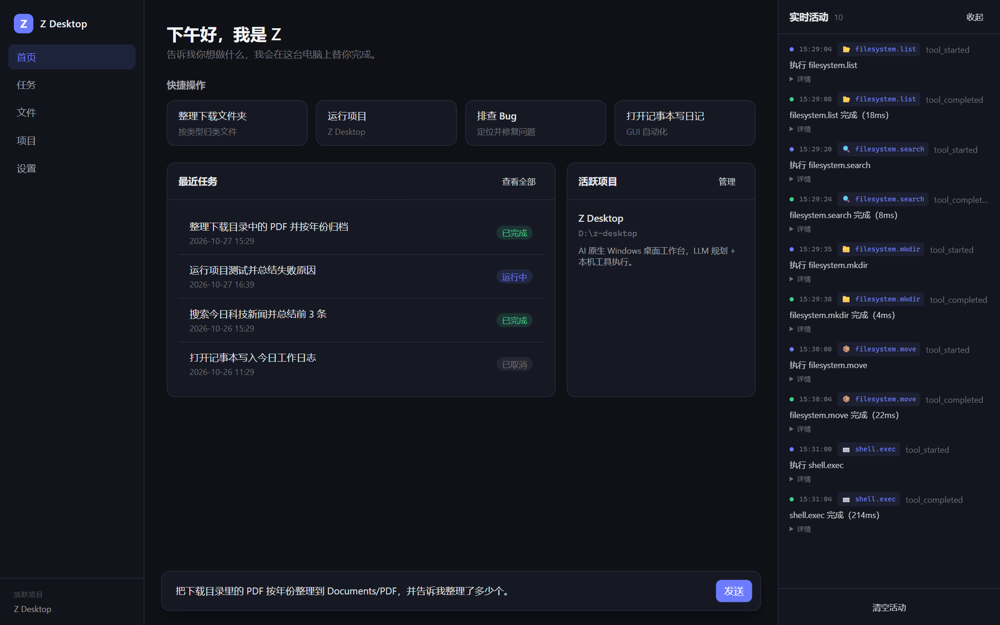
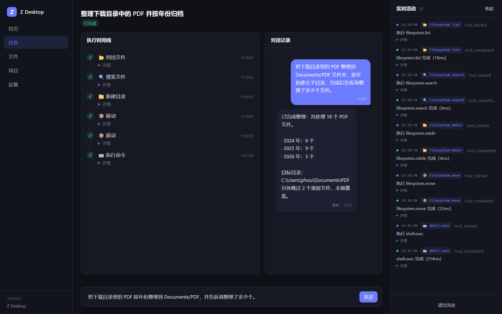
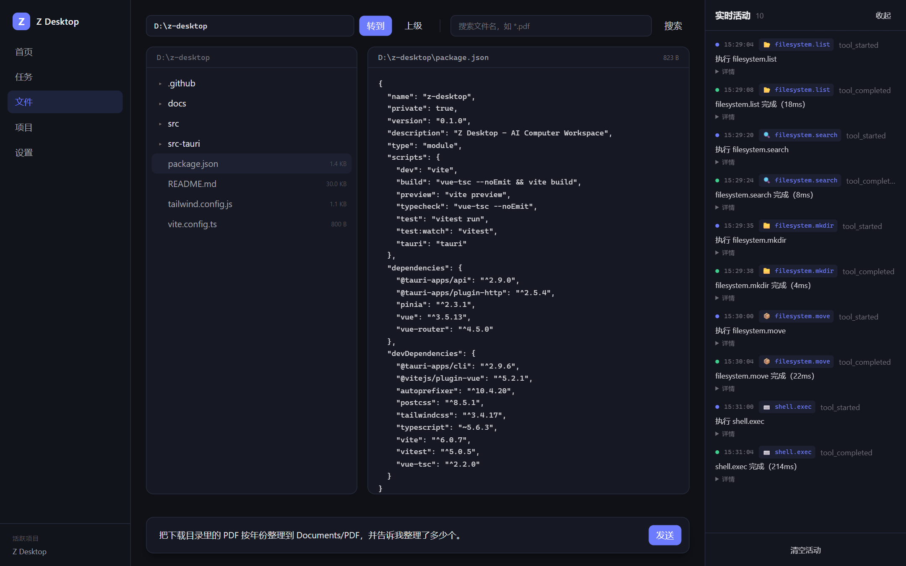
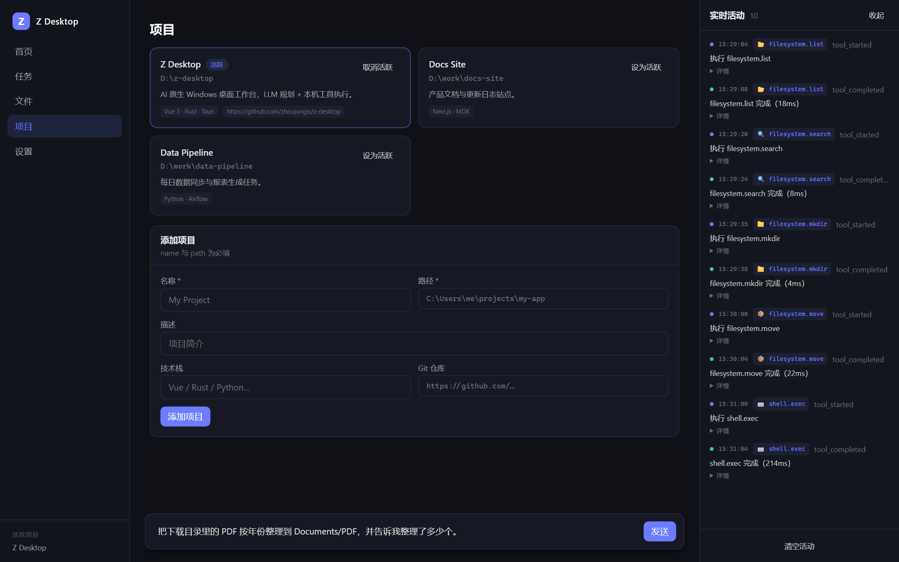
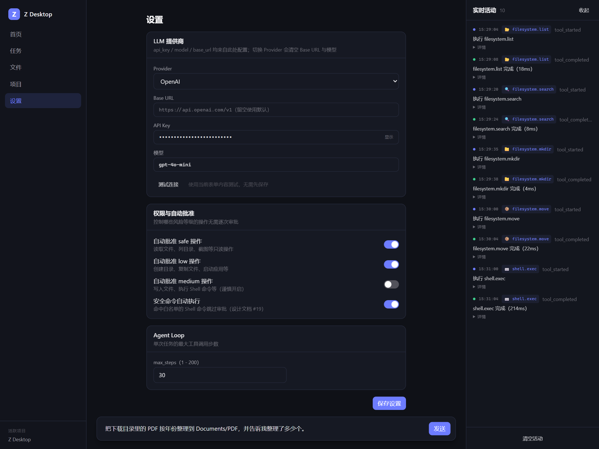
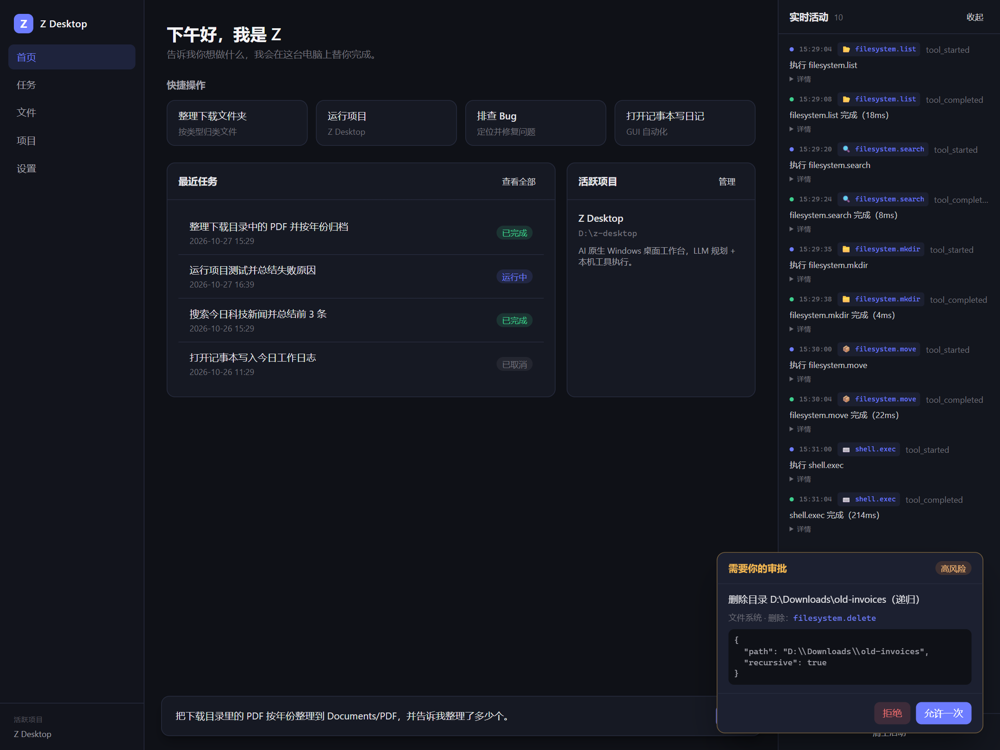

# Z Desktop

**AI Computer Workspace** — AI 原生 Windows 桌面工作台。

Z Desktop 让 AI 在用户授权下观察电脑、理解任务、调用工具、操作应用、验证结果并完成任务。它不是“只会聊天的侧边栏”，而是一个把 **LLM 规划能力** 与 **本机真实执行能力** 接起来的桌面 Agent：文件、Shell、进程、窗口、GUI、浏览器、截图、剪贴板都是它的工具，而每一次高风险动作都必须经过 Rust 侧的安全校验与用户审批。

> 当前版本：**v0.1.0** · Windows 10/11 · Tauri 2 + Vue 3 + Rust · MIT

---

## 界面预览

> 以下为界面示意，使用示例数据生成。

| 首页 | 任务详情 |
|---|---|
|  |  |
| **文件管理** | **项目管理** |
|  |  |
| **设置与连接测试** | **高风险操作审批** |
|  |  |

---

## 目录

- [界面预览](#界面预览)
- [1. 核心特性](#1-核心特性)
- [2. 界面与工作流](#2-界面与工作流)
- [3. 快速开始](#3-快速开始)
- [4. 架构总览](#4-架构总览)
- [5. Agent Loop](#5-agent-loop)
- [6. 工具系统](#6-工具系统)
- [7. 安全与权限](#7-安全与权限)
- [8. LLM 接入](#8-llm-接入)
- [9. 数据与持久化](#9-数据与持久化)
- [10. 项目结构](#10-项目结构)
- [11. 开发、测试与 CI](#11-开发测试与-ci)
- [12. 常见问题](#12-常见问题)
- [13. 路线图](#13-路线图)
- [14. 文档索引](#14-文档索引)
- [15. 贡献](#15-贡献)

---

## 1. 核心特性

### Agent 与模型

- **多 Provider LLM**：OpenAI / Anthropic / Gemini / OpenRouter / 自定义 OpenAI 兼容 API / 本地模型（Ollama 等）。
- **流式输出**：思考过程实时显示，工具调用使用各 Provider 原生 function calling 协议。
- **Agent Loop**：思考 → 规划 → 执行 → 观察 → 验证，自动纠偏、失败重试、随时停止。
- **自动验证**：任务收尾前由 LLM 校验完成度；连续两次未通过会保留结果并标注验证意见，避免死循环。
- **上下文注入**：当前时间、活跃项目、技术栈、FTS5 长期记忆。

### 本机能力（44 个工具）

- **文件系统**：读取、写入、搜索、复制、移动、重命名、建目录、删除、元信息。
- **Shell**：PowerShell / CMD / WSL / Git Bash，支持工作目录、超时、取消与输出截断。
- **进程**：查看、详情、启动应用、终止进程。
- **窗口**：枚举、查找、聚焦、最小化、最大化、关闭（Windows）。
- **GUI 自动化**：Windows UI Automation，控件定位优先级 `AutomationId > Name > ControlType`。
- **浏览器**：CDP 驱动本机 Chrome/Edge，导航、搜索、点击、输入、滚动、提取、截图、下载。
- **截图**：全屏、窗口、区域截图，支持多显示器。
- **剪贴板**：读 / 写文本。

### 安全与可观测

- **五级风险模型**：SAFE / LOW / MEDIUM / HIGH / CRITICAL。
- **权限判定在 Rust 侧强制完成**，前端无法绕过。
- **审批 UI**：拒绝 / 允许一次 / 总是允许；Always-allow 只对 MEDIUM 及以下生效。
- **Shell 命令分级**：按 `&& / || / ; / |` 拆段逐段分级，链式危险命令无法借 SAFE 白名单自动执行。
- **路径沙箱**：拦截系统保护目录，解析 `..`、相对路径与符号链接。
- **随时停止**：取消标志 + 终止任务相关进程树。
- **实时活动面板 / 任务时间线 / 对话记录 / 审批卡片**。

### 工程化

- TypeScript 严格模式、Vue 3 `<script setup>`、Pinia、Vue Router（Hash）。
- Rust 单元测试 + 端到端集成测试，Clippy 零警告。
- GitHub Actions：PR 全量校验、Windows NSIS/MSI 打包、自动打 tag 与发布 Release。

---

## 2. 界面与工作流

应用采用三栏布局：

| 区域 | 内容 |
|---|---|
| 左侧导航 | 首页 / 任务 / 文件 / 项目 / 设置；当前活跃项目 |
| 中间主区 | 页面内容 + 底部全局 Chat 输入 |
| 右侧面板 | 实时活动流（Activity），可收起 |
| 全局浮层 | 审批卡片（ApprovalCard） |

### 页面

- **首页**：问候、未配置模型引导、快捷操作、最近任务、活跃项目。
- **任务**：任务列表与任务详情（结构化执行步骤 + 对话记录 + 复制消息 + 流式思考预览 + 停止按钮）。
- **文件**：目录树、文本 / 图片预览、按通配符搜索（如 `*.pdf`）。
- **项目**：添加 / 设置活跃项目；Agent 会优先以项目路径作为工作目录。
- **设置**：LLM Provider、API Key 显示/隐藏、连接测试、模型、自动批准策略、`max_steps`。

### 一次典型任务

1. 在底部输入任务，例如「整理下载目录里的 PDF」。随时按 `Ctrl/Cmd+K` 聚焦输入框。
2. Agent 读取工具清单与上下文，调用 LLM 规划下一步。
3. 工具调用进入 Rust：安全判定 → 直接执行 / 弹审批 / 拦截。
4. 每一步的输入、输出、状态实时进入 Activity 与 Task Timeline。
5. LLM 输出最终总结，验证器判定完成后任务结束。
6. 全程可点击「停止」：立即中断进行中的 LLM 流式请求，并终止相关进程树。

---

## 3. 快速开始

### 3.1 环境要求

| 依赖 | 要求 |
|---|---|
| Node.js | 20 LTS 或更高（CI 使用 Node 20） |
| Rust | stable（建议 1.88+） |
| 系统 | Windows 10 / 11（GUI / 窗口工具仅 Windows） |
| WebView2 | Windows 10/11 通常已内置；缺失时安装 Evergreen Runtime |
| 浏览器工具 | 本机安装 Chrome 或 Edge（Chromium 内核） |
| 构建工具 | MSVC Build Tools + Windows SDK（Tauri 官方前置要求） |

非 Windows 平台可以编译运行，但 `window.*` / `ui.*` / `screenshot.window` 等 Windows 专属工具会返回友好提示。

### 3.2 安装与启动

```bash
# 安装依赖
npm install

# 开发模式（Vite + Tauri，推荐）
npm run tauri dev

# 仅前端开发（浏览器模式，无法调用 Rust / LLM）
npm run dev
```

> 浏览器模式只用于查看界面，所有 `invoke` 与 LLM 请求都会提示需要 Tauri 环境。

### 3.3 构建安装包

```bash
# Windows：产出 NSIS .exe 与 MSI
npm run tauri build

# 仅构建前端
npm run build
```

产物位置：

```text
src-tauri/target/release/bundle/nsis/*.exe
src-tauri/target/release/bundle/msi/*.msi
```

### 3.4 配置模型

首次启动后进入 **设置**：

1. 选择 Provider。
2. 填写 API Key（本地模型可留空）。
3. 按需填写 Base URL 与模型名（留空使用默认值）。
4. 点击「测试连接」验证配置（使用当前表单内容，无需先保存）。
5. 选择自动批准策略，保存后立即生效。

### 3.5 试试这些任务

- 「把下载目录里的 PDF 整理到 `Documents/PDF` 文件夹，并按年份建立子目录」
- 「运行这个项目的测试，总结失败原因并尝试修复」
- 「打开记事本，输入 Hello Z Desktop，保存到桌面」
- 「搜索今天的科技新闻，总结前 3 条并写入 `news.md`」
- 「查看当前内存占用最高的 10 个进程」

---

## 4. 架构总览

### 4.1 分层

```text
┌──────────────────────────────────────────────────────────────┐
│                    Frontend（WebView / Vue 3）                │
│  Pages · Components · Pinia Stores                           │
│  Agent Loop（规划 / 执行 / 观察 / 验证）· LLM Provider 适配   │
└───────────────────────────┬──────────────────────────────────┘
                            │ Tauri IPC（invoke + event）
┌───────────────────────────┴──────────────────────────────────┐
│                      Rust Core（src-tauri）                   │
│  commands.rs   20 个 Tauri 命令（薄转发层）                    │
│  agent/        审批队列 · 执行入口 · 取消                      │
│  security/     风险分级 · 权限判定 · 路径沙箱                  │
│  tools/        44 个工具定义 + 统一执行注册表                  │
│  database/     SQLite + FTS5 · 迁移 · CRUD                    │
│  windows/      UIA · 窗口 · 进程树（Windows 专用）             │
│  state.rs      AppState：DB / 审批 / PID / 浏览器会话          │
└──────────────────────────────────────────────────────────────┘
```

### 4.2 职责边界

| 层 | 职责 |
|---|---|
| 前端 | 状态机、LLM 调用与流式渲染、Prompt 组装、审批 UI、任务与活动展示 |
| Rust | 权限判定、路径沙箱、工具执行、进程管理、SQLite 持久化、事件广播 |

**核心原则：规划可以放在前端，安全必须收口在后端。** 任何工具调用最终都要经过 `request_tool_execution()`。

### 4.3 一次工具调用的数据流

```text
Agent Loop
  → invoke("tool_execute", { taskId, tool, input, approvalRequestId? })
  → security::permission::decide()
      ├─ CRITICAL           → { status: "blocked" }
      ├─ 需审批             → pending_approvals 入队
      │                       emit("approval-requested")
      │                       前端等待 approval-resolved
      │                       allow → 带 requestId 重发
      │                       deny  → 作为失败观察结果返回
      └─ 自动允许 / 已批准   → tools::registry::execute()
  → emit("activity", tool_started / completed / failed / blocked)
  → 返回 { status, result | error | reason, durationMs }
  → Loop 把结果写入消息历史，继续下一轮
```

### 4.4 关键设计决策

1. **Agent Loop 在前端**：便于流式展示与状态机 UI；工具执行与安全在 Rust。
2. **工具 schema 单一来源在 Rust**：前端只维护展示用元数据，避免双份定义漂移。
3. **审批复用校验**：重放时必须工具名与完整输入一致，防止“批准 A、执行 B”。
4. **阻塞调用隔离**：文件 / UIA / 截图等同步实现统一经 `spawn_blocking`，不阻塞 async runtime。
5. **平台桩实现**：非 Windows 平台编译出返回提示的 `window.*` / `ui.*`，保证跨平台可构建。

---

## 5. Agent Loop

### 5.1 状态机

```text
IDLE → THINKING → PLANNING → EXECUTING → OBSERVING → VERIFYING
         ↑                                          │
         │                 未通过 / 需继续            │
         └──────────────────────────────────────────┘
                              │
                              ├─ 通过 → COMPLETED
                              └─ 用户停止 → CANCELLED

LLM 临时失败 → RECOVERING → 重试一次
任意异常     → ERROR
审批等待     → WAITING_APPROVAL → allow → EXECUTING / deny → 继续规划
```

状态由 `src/stores/agent.ts` 持有，主循环在 `src/agent/loop.ts`。

### 5.2 循环步骤

1. **收集上下文**：工具清单、时间、活跃项目、相关记忆。
2. **调用 LLM（流式）**：把思考增量写入 `thinkingText`。
3. **有工具调用**：逐个执行，把结果压缩成观察消息回填。
4. **无工具调用**：进入验证器；通过则落库并完成。
5. **失败重试**：LLM 临时错误自动重试一次；工具错误作为观察结果交给模型自行修正。

### 5.3 保护机制

| 机制 | 默认 / 说明 |
|---|---|
| `max_steps` | 默认 30，可配置 1–200 |
| LLM 重试 | 临时错误自动重试 1 次 |
| 验证收敛 | 连续 2 次验证未通过则保留输出并标注原因 |
| 观察截断 | 单条工具结果最长 4000 字符 |
| 思考文本 | UI 只保留最近 2000 字符 |
| 活动流 | 最多保留 300 条 |
| 停止 | 每步检查取消标志；中断进行中的 LLM 请求；Shell 以 100ms 轮询取消 |
| 步骤落库 | 每次工具调用写入 `task_steps`（输入/输出/状态），供时间线回放 |

---

## 6. 工具系统

### 6.1 统一调用协议

```jsonc
// 请求
{ "taskId": "uuid", "tool": "filesystem.read", "input": { "path": "D:/a.txt" } }

// 响应
{ "status": "executed", "result": { "...": "..." }, "durationMs": 12 }
```

`status` 取值：

| 状态 | 含义 |
|---|---|
| `executed` | 执行成功 |
| `failed` | 工具返回错误（会作为观察结果交给 LLM） |
| `blocked` | 安全策略直接拦截（如 CRITICAL） |
| `approval_required` | 等待用户审批，返回 `requestId` |
| `cancelled` | 任务已被用户停止 |

### 6.2 工具清单（44 个）

#### 文件系统（10）

| 工具 | 风险 | 说明 |
|---|---|---|
| `filesystem.list` | safe | 列目录（支持深度，最多 2000 条） |
| `filesystem.read` | safe | 读文件（文本 / base64，默认 2MB，上限 50MB） |
| `filesystem.write` | medium | 写文件，自动创建父目录，`content` 必填 |
| `filesystem.search` | safe | 文件名通配符递归搜索，如 `*.pdf` |
| `filesystem.copy` | low | 复制文件 / 目录，可覆盖；禁止复制到自身内部 |
| `filesystem.move` | medium | 移动文件 / 目录，跨卷自动 copy + delete |
| `filesystem.rename` | low | 仅重命名，不接受路径分隔符 / `.` / `..` |
| `filesystem.mkdir` | low | 递归创建目录 |
| `filesystem.delete` | high | 删除文件 / 目录，目录非空需 `recursive` |
| `filesystem.stat` | safe | 大小、修改时间、类型、只读状态 |

#### Shell（1）

| 工具 | 风险 | 说明 |
|---|---|---|
| `shell.exec` | 动态 | PowerShell / CMD / WSL / Git Bash，支持 cwd、timeout、取消；stdout/stderr 只保留尾部 100KB |

> `shell.exec` 的最终风险由命令内容决定：只读命令可为 SAFE，未知命令 MEDIUM，危险命令 HIGH / CRITICAL。

#### 进程（4）

| 工具 | 风险 | 说明 |
|---|---|---|
| `process.list` | safe | 进程列表，可按名称过滤、按内存排序 |
| `process.inspect` | safe | 单进程详情：exe、命令行、cwd、父进程、CPU、内存 |
| `process.start` | low | 启动应用（分离模式，返回 PID） |
| `process.kill` | high | 终止进程 |

#### 窗口（6，Windows）

| 工具 | 风险 | 说明 |
|---|---|---|
| `window.list` | safe | 枚举顶层窗口 |
| `window.find` | safe | 按标题包含匹配查找 |
| `window.focus` | low | 聚焦窗口 |
| `window.minimize` | low | 最小化 |
| `window.maximize` | low | 最大化 |
| `window.close` | medium | 关闭窗口 |

#### UI 自动化（7，Windows）

| 工具 | 风险 | 说明 |
|---|---|---|
| `ui.inspect` | safe | 遍历 UI 树（Name / AutomationId / ControlType / Rect） |
| `ui.find` | safe | 按条件查找控件 |
| `ui.click` | medium | 点击：Invoke 模式优先，坐标点击兜底 |
| `ui.type` | medium | 聚焦后输入，可先清空 |
| `ui.select` | medium | SelectionItem → Invoke → 坐标 |
| `ui.getValue` | safe | 读取控件值 |
| `ui.getText` | safe | 读取控件文本 / 文档内容 |

#### 浏览器（11）

| 工具 | 风险 | 说明 |
|---|---|---|
| `browser.open` | low | 启动 / 复用 Chrome/Edge 会话 |
| `browser.goto` | safe | 导航并等待加载 |
| `browser.back` | safe | 后退 |
| `browser.forward` | safe | 前进 |
| `browser.search` | safe | Bing 搜索 |
| `browser.click` | medium | CSS 选择器或按文本点击 |
| `browser.type` | medium | 输入文本，可回车提交 |
| `browser.scroll` | safe | 页面滚动 |
| `browser.extract` | safe | 提取元素 / 整页文本 |
| `browser.screenshot` | safe | 页面截图 |
| `browser.download` | medium | 下载文件（上限 10MB，落盘经沙箱） |

#### 截图（3）

| 工具 | 风险 | 说明 |
|---|---|---|
| `screenshot.full` | safe | 全屏截图（多屏按编号） |
| `screenshot.window` | safe | 窗口截图（UIA 取矩形） |
| `screenshot.region` | safe | 区域截图，支持负坐标 |

#### 剪贴板（2）

| 工具 | 风险 | 说明 |
|---|---|---|
| `clipboard.read` | safe | 读取剪贴板文本 |
| `clipboard.write` | low | 写入剪贴板文本 |

### 6.3 新增工具

1. 在 `src-tauri/src/tools/<module>.rs` 实现 `pub fn xxx(input: &Value) -> Result<Value, String>`。
2. 在 `registry.rs::execute()` 登记分支（阻塞实现用 `run_blocking` 包裹）。
3. 在 `tool_definitions()` 追加 `ToolDef`（名称 / 描述 / JSON Schema / 风险等级）。
4. 在 `state.rs::tool_risk` 补充风险等级。
5. 前端 `src/tools/` 增加展示元数据（可选）。
6. 补单测 / 集成测试。

---

## 7. 安全与权限

### 7.1 五级风险

| 等级 | 默认行为 | 示例 |
|---|---|---|
| SAFE | 自动允许（可配置） | 读文件、列目录、查进程、截图、读剪贴板 |
| LOW | 可配置自动 | 复制 / 重命名、启动应用、写剪贴板 |
| MEDIUM | 需审批（可配置自动） | 写文件、移动文件、关窗口、UI 点击、未知 Shell |
| HIGH | 每次确认 | 删除、杀进程、安装软件、注册表写、`git push` |
| CRITICAL | **默认禁止** | 格式化、关机、改 HKLM、关 Defender、fork 炸弹 |

规则：

- CRITICAL 直接 `blocked`，不弹审批。
- HIGH 忽略自动批准与 Always-allow，每次人工确认。
- Always-allow 只对 MEDIUM 及以下生效，且按 `tool + 完整 input` 精确匹配。

### 7.2 Shell 命令分级

`security/risk.rs` 会对命令做归一化，然后：

- 按 `&&`、`||`、`;`、`|`、换行拆成独立片段。
- 逐段判定风险，取最高值。
- 只有**所有片段**都是只读命令时才判定 SAFE。
- 重定向 `>` 会让命令退出 SAFE 判定。
- 只读前缀必须构成完整单词，避免 `catalog.exe` 命中 `cat`、`cdx` 命中 `cd`。

例如：

```text
echo ok && rm -rf ./build      → HIGH（不会因为 echo 是 SAFE 就自动执行）
cd D:\ && del important.txt    → HIGH
git status && git push         → HIGH
dir | findstr foo              → SAFE
echo hi > out.txt              → MEDIUM
```

设置项 `shell_safe_auto_exec` 关闭后，即使是只读 Shell 命令也需要审批。

### 7.3 路径沙箱

保护目录（拒绝写 / 删 / 移入）：

```text
C:\Windows
C:\Program Files
C:\Program Files (x86)
C:\ProgramData\Microsoft
/bin  /boot  /etc  /lib  /lib64  /sbin  /usr  /var  /sys  /proc
```

路径检查会：

- 解析 `..`；
- 补全相对路径；
- 尽可能解析符号链接（保留最后一层不存在的目标）；
- 同时检查输入形态与真实路径，保留 Windows 上 `/etc`、`/usr` 这类 Unix 风格路径的保护语义。

### 7.4 审批生命周期

```text
request_tool_execution
  → 生成 requestId，先入队，再广播 approval-requested
  → 前端展示风险等级、摘要、完整参数
  → resolve_approval(requestId, allow | deny, alwaysAllow)
  → 广播 approval-resolved，唤醒 Loop
  → allow：校验 tool + input 完全一致后执行
  → deny：立即移除请求，作为失败观察结果返回
```

- 重复审批会返回“已处理”，避免竞态。
- 任务取消时会清理该任务的待审批请求。
- 前端审批按钮在提交期间禁用，防止重复点击。

### 7.5 取消与进程管理

- 每个任务启动的 Shell / 应用 PID 记录在 `AppState.running_pids`。
- 停止任务：置取消标志 + `taskkill /T /F` 终止进程树。
- Shell 工具内部每 100ms 检查取消标志，超时 / 取消后还会用 `Child::kill` 兜底，确保不会永久等待。

### 7.6 已知安全边界

- API Key 以明文存放在本机 SQLite，v0.2 计划迁移到 OS Keychain。
- 命令分级是启发式规则，不等同于操作系统级沙箱；不要用它运行来源不明的脚本。
- UI 自动化只支持 Windows；自绘界面（Qt / 游戏）可能无法定位控件。
- 浏览器自动化依赖本机 Chrome/Edge 与 CDP。
- 当前同一时间只运行一个 Agent 任务。
- 事件表暂无自动归档；截图目录暂无清理策略。
- 暂无内置自动更新器；发布以 GitHub Release 安装包为准。

---

## 8. LLM 接入

### 8.1 Provider

| Provider | 协议 | 默认 Base URL | 默认模型 |
|---|---|---|---|
| `openai` | OpenAI Chat Completions | `https://api.openai.com/v1` | `gpt-4o-mini` |
| `anthropic` | Anthropic Messages | `https://api.anthropic.com` | `claude-3-5-sonnet-latest` |
| `gemini` | Gemini generateContent | `https://generativelanguage.googleapis.com` | `gemini-1.5-flash` |
| `openrouter` | OpenAI 兼容 | `https://openrouter.ai/api/v1` | `gpt-4o-mini` |
| `custom` | OpenAI 兼容 | 建议填写；留空回退 OpenAI | `gpt-4o-mini` |
| `local` | OpenAI 兼容（Ollama 等） | `http://localhost:11434/v1` | `qwen2.5:7b` |

- `local` 允许 API Key 留空。
- Base URL 与模型留空时使用上表默认值。
- 网络请求通过 `tauri-plugin-http` 发出；`src-tauri/capabilities/default.json` 允许 `https://**`、`http://localhost:*`、`http://127.0.0.1:*`。

### 8.2 流式与工具调用

| Provider | 流式解析 | 工具调用 |
|---|---|---|
| OpenAI 兼容 | SSE `choices[].delta` | `tools` / `tool_calls` |
| Anthropic | SSE `content_block_delta` | `tool_use` / `tool_result` content block |
| Gemini | SSE `generateContent` | `functionDeclarations` / `functionCall` |

### 8.3 设置项

| 字段 | 说明 |
|---|---|
| `provider` | Provider 名称 |
| `base_url` | 自定义 API 地址 |
| `api_key` | 密钥（本地模型可空） |
| `model` | 模型名 |
| `auto_approve_safe` | 自动批准 SAFE（默认开） |
| `auto_approve_low` | 自动批准 LOW |
| `auto_approve_medium` | 自动批准 MEDIUM |
| `shell_safe_auto_exec` | 只读 Shell 命令自动执行（默认开） |
| `max_steps` | 单任务最大步数（1–200，默认 30） |

---

## 9. 数据与持久化

### 9.1 存储位置

```text
{app_data_dir}/zdesktop.db          # SQLite（WAL 模式）
{app_data_dir}/screenshots/         # 截图 PNG
```

Windows 下 `{app_data_dir}` 通常为：

```text
%APPDATA%\com.zdesktop.app\
```

### 9.2 表结构

| 表 | 用途 |
|---|---|
| `tasks` | 任务标题、状态、时间 |
| `task_steps` | 任务步骤（工具、输入、输出、状态） |
| `events` | 活动事件流水 |
| `messages` | 用户 / 助手消息 |
| `memories` | 长期记忆 |
| `memories_fts` | FTS5 虚拟表 + 触发器同步 |
| `projects` | 项目与活跃状态 |
| `settings` | 键值设置（JSON） |
| `approval_rules` | Always-allow 规则 |
| `schema_migrations` | 迁移版本 |

- 主键统一 UUID，时间统一 Unix 毫秒。
- `search_memories` 会清洗 FTS5 特殊字符后再查询，避免 `*`、`"`、`:` 导致 MATCH 报错。

### 9.3 记忆检索

Agent 启动时会从任务描述中提取关键词，通过 FTS5 检索相关记忆并注入 system prompt。当前没有独立的记忆管理界面，可通过 `add_memory` / `search_memories` 命令扩展。

---

## 10. 项目结构

```text
z-desktop/
├── .github/workflows/release.yml   # CI：测试 / 打包 / 自动 tag + release
├── apps/desktop/                   # 多应用入口占位
├── database/migrations/
│   └── 0001_init.sql               # 8 张业务表 + FTS5 + 触发器
├── docs/                           # 架构 / Agent / 工具 / 安全 / 数据库 / 路线图
│   └── screenshots/                # README 界面截图
├── public/                         # 静态资源
├── src/                            # Vue 3 前端
│   ├── agent/
│   │   ├── loop.ts                 # Agent 主循环
│   │   ├── planner.ts              # system prompt 与工具转换
│   │   ├── executor.ts             # 工具调用封装
│   │   ├── verifier.ts             # 结果验证
│   │   ├── context.ts              # 项目 / 记忆 / 时间
│   │   ├── types.ts
│   │   └── *.test.ts
│   ├── assets/style.css
│   ├── components/
│   │   ├── activity/               # 实时活动面板
│   │   ├── approval/               # 审批卡片
│   │   ├── chat/                   # 输入框 / 消息列表
│   │   ├── common/                 # EmptyState / SectionCard
│   │   ├── files/                  # 文件树 / 预览
│   │   └── task/                   # 任务列表 / 时间线 / 状态徽章
│   ├── pages/                      # Home / Task / Files / Projects / Settings
│   ├── router/index.ts
│   ├── services/
│   │   ├── api.ts                  # 20 个命令 + 类型
│   │   ├── events.ts               # 事件监听 / 审批等待
│   │   ├── llm.ts                  # 多 Provider 适配
│   │   └── tauri.ts                # invoke 包装
│   ├── stores/                     # agent / task / workspace / settings
│   ├── tools/                      # 工具展示元数据
│   ├── App.vue
│   └── main.ts
├── src-tauri/                      # Rust Core
│   ├── capabilities/default.json   # Tauri 权限
│   ├── src/
│   │   ├── agent/mod.rs            # 审批队列 / 取消 / 执行入口
│   │   ├── commands.rs             # 20 个 Tauri 命令
│   │   ├── database/               # 迁移 / 模型 / 连接
│   │   ├── security/               # risk / permission / sandbox
│   │   ├── state.rs                # AppState
│   │   ├── tools/                  # registry + 8 个实现模块
│   │   ├── windows/                # UIA / 窗口 / 进程树
│   │   ├── lib.rs
│   │   └── main.rs
│   ├── tests/integration.rs        # 端到端集成测试
│   ├── build.rs                    # Tauri 构建 + Windows 测试链接修正
│   ├── Cargo.toml
│   └── tauri.conf.json
├── index.html
├── package.json
├── postcss.config.js
├── tailwind.config.js
├── tsconfig.json
├── vite.config.ts
└── vitest.config.ts
```

---

## 11. 开发、测试与 CI

### 11.1 常用命令

| 命令 | 作用 |
|---|---|
| `npm install` | 安装依赖 |
| `npm run tauri dev` | 桌面开发模式 |
| `npm run dev` | 仅前端（浏览器模式，功能受限） |
| `npm run typecheck` | Vue / TS 类型检查 |
| `npm run build` | 类型检查 + 前端生产构建 |
| `npm test` | 前端单元测试 |
| `npm run test:watch` | 前端测试监听 |
| `npm run tauri build` | 构建 Windows 安装包 |
| `cargo fmt --all -- --check` | Rust 格式检查 |
| `cargo test --all-targets --locked` | Rust 单元 + 集成测试 |
| `cargo clippy --all-targets --locked -- -D warnings` | Clippy 零警告检查 |

### 11.2 测试覆盖

| 层 | 文件 | 数量 |
|---|---|---|
| 前端 | `llm.test.ts` / `verifier.test.ts` / `planner.test.ts` / `registry.test.ts` / `path.test.ts` | 35 |
| Rust 单元 | security / database / filesystem / shell / agent | 42 |
| Rust 集成 | `src-tauri/tests/integration.rs` | 21 |

Rust 集成测试覆盖：文件系统全生命周期、Shell 输出 / 退出码 / 超时 / 取消 / cwd、进程枚举、CRITICAL 拦截、审批 Allow/Deny/Always、审批重放参数校验、任务取消、SQLite CRUD、FTS5 同步、沙箱归一化。

> Windows 说明：`build.rs` 对测试目标延迟加载 `comctl32.dll`，解决 Tauri 测试二进制缺少应用清单导致的 `STATUS_ENTRYPOINT_NOT_FOUND`。

### 11.3 GitHub Actions

`.github/workflows/release.yml`：

| Job | 运行环境 | 内容 |
|---|---|---|
| **Test** | `windows-latest` | 版本一致性 → `typecheck` → 前端单测 → Rust 格式检查 → Rust 单测 / 集成测试 → Clippy `-D warnings` |
| **Build** | `windows-latest` | `tauri build --bundles nsis,msi`，上传 `.exe` / `.msi` artifact |
| **Release** | `ubuntu-latest` | 读取版本号 → 检查 tag → 生成 SHA256 → 创建 tag / GitHub Release |

触发方式：

| 事件 | 行为 |
|---|---|
| Pull Request | Test + Build，不发布 |
| push `main` / `master` | Test + Build；tag 不存在时自动发布 |
| `workflow_dispatch` | 同 push |

### 11.4 发布新版本

1. 同步提升三处版本号：
   - `package.json`
   - `src-tauri/tauri.conf.json`
   - `src-tauri/Cargo.toml`
2. 合并到 `main` / `master`。
3. workflow 自动创建 `vX.Y.Z` tag，并发布附带以下文件的 Release：
   - NSIS 安装包 `.exe`
   - MSI 安装包 `.msi`
   - `SHA256SUMS.txt`

规则：

- 版本号未变、tag 已存在 → 跳过发布并输出 notice。
- 版本号包含 `-`（如 `0.2.0-beta.1`）→ 自动标记为 prerelease。
- 工作流会先做版本一致性检查，三处版本不一致会直接失败。
- 首次使用需在仓库 **Settings → Actions → General → Workflow permissions** 允许
  `Read and write permissions`（或允许 workflow 申请 `contents: write`）。

---

## 12. 常见问题

**Q：`npm run dev` 打开网页后所有功能都报“请使用 Tauri 启动”？**
A：浏览器模式无法调用 Rust 与 LLM，请使用 `npm run tauri dev`。

**Q：提示 `vitest` / `vue-tsc` 不存在？**
A：依赖被以 production 模式安装。执行 `npm install --include=dev`，或检查 `npm config get omit`。

**Q：LLM 报“未配置 API Key”？**
A：到设置页填写密钥；只有 `local` Provider 允许留空。

**Q：浏览器工具启动失败？**
A：需要本机安装 Chrome 或 Edge（Chromium 内核），并且允许启动子进程。

**Q：`ui.*` / `window.*` 返回“仅支持 Windows”？**
A：这些工具依赖 Windows UI Automation，跨平台构建只提供桩实现。

**Q：`ui.find` 找不到控件？**
A：先用 `ui.inspect` 查看 UI 树，优先使用 `automation_id`；自绘界面可能需要视觉定位（v0.3 计划）。

**Q：端口 5173 被占用？**
A：Vite 使用 `strictPort`，请释放端口或修改 `vite.config.ts` 与 `tauri.conf.json` 的 `devUrl`。

**Q：如何重置本地数据？**
A：关闭应用后删除 `%APPDATA%\com.zdesktop.app\zdesktop.db` 与 `screenshots/`（会丢失任务、设置与项目）。

**Q：想调大任务步数？**
A：设置页 `max_steps` 支持 1–200，默认 30。

---

## 13. 路线图

- **v0.2**：API Key 迁移 OS Keychain、批量审批、Shell 资源限制、事件归档、多显示器截图选择器。
- **v0.3**：Vision 定位兜底、浏览器会话持久化、定时任务 / 工作流、MCP 工具接入、插件系统。
- **v1.0**：安装包自动更新、崩溃恢复、多任务并行、组织级审批策略、国际化。

详细内容见 [docs/roadmap.md](docs/roadmap.md)。

---

## 14. 文档索引

| 文档 | 内容 |
|---|---|
| [docs/architecture.md](docs/architecture.md) | 总体架构、通信模型、数据流、设计决策 |
| [docs/agent.md](docs/agent.md) | 状态机、Agent Loop、规划 / 验证、审批与取消 |
| [docs/tools.md](docs/tools.md) | 44 个工具清单、输入输出、新增工具指南 |
| [docs/security.md](docs/security.md) | 风险模型、命令分级、沙箱、审批流 |
| [docs/database.md](docs/database.md) | Schema、FTS5、访问层 |
| [docs/roadmap.md](docs/roadmap.md) | v0.1 交付清单与 v0.2+ 路线 |

---

## 15. 贡献

提交 PR 前请确保以下命令全部通过：

```bash
npm run typecheck
npm test
cargo fmt --all -- --check
cargo test --all-targets --locked
cargo clippy --all-targets --locked -- -D warnings
```

约定：

- 安全相关改动必须补测试（命令分级、沙箱、审批流优先）。
- 新增工具需同时更新 Rust 注册表、风险等级、前端展示元数据与文档。
- 修改版本号时同步 `package.json`、`src-tauri/tauri.conf.json`、`src-tauri/Cargo.toml`。
- 不要在前端绕过 `tool_execute` 直接调用系统能力。

---

## License

MIT
